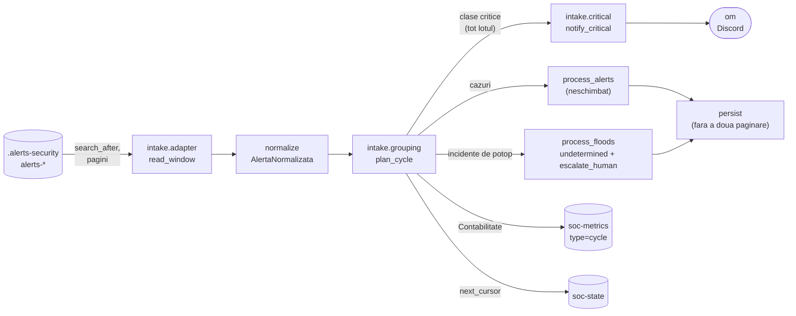

# Monolitul modular: module, interfete, dependente

Scris 2026-11-24 (faza 26), fara diacritice. Completeaza docs/arhitectura.md (fluxul de verdict) cu
structura codului: ce modul face ce, prin ce interfata vorbeste cu celelalte si ce n-are voie sa
importe. Regulile de import sunt verificate de `.importlinter` (import-linter 2.17).

## De ce monolit modular si nu microservicii

Un singur depozit, un singur venv, o singura versiune a logicii de verdict; procesele (azi unul,
dupa faza cozilor patru) importa aceleasi module. Ce se castiga fata de orchestratorul de azi:

- **cuplare slaba**: modulele isi vorbesc prin mesaje cu forma fixa (`contracts/messages.py`,
  `extra="forbid"`, `schema_version`), nu prin dictionare si variabile globale;
- **izolare**: un modul de jos nu stie de cele de sus (intrarea nu stie de verdict, brokerul nu stie
  de logica, logica nu stie de intrare); dependentele se injecteaza (clientul ES, trimiterea
  notificarilor), deci fiecare modul se testeaza singur, fara retea;
- **acelasi cod in ambele moduri**: `SOC_PIPELINE=legacy|intake` (si `queue`, mai tarziu) schimba
  doar cablajul din `apps/`, nu logica.

Ce NU se castiga (si nu se pretinde): izolare de proces intre module (o exceptie de import le
opreste pe toate), scalare independenta pe module (vine doar odata cu cozile si workerii).

## Straturile

```
apps        orchestrator, label_ui (si, la cozi: adaptor, worker_t1, worker_t2, scriitor)
  │  cablaj: citeste mediul, construieste clientii, leaga modulele
ops eval extras tier3
  │
tier1  tier2        logica de verdict (NU se rescrie): fast_path, hunt_path, escalation, policy
intake  bus  store  intrare / transport / scriere
  │
core                functii pure comune (eventtime, degraded, policy, honeytokens, prompts)
contracts           forme de date (schemas, messages); nu importa nimic din pachet
```

| Modul | Rol | Interfata publica | Poate importa (tinta; verificat doar unde exista contract) |
|---|---|---|---|
| `contracts` | forme de date care trec granitele | `schemas.Verdict`, `schemas.Case`, `messages.AlertaNormalizata`, `messages.Contabilitate`, `messages.CriticalClass` | nimic din pachet |
| `core` | reguli pure comune | `eventtime.*`, `degraded.*`, `policy.decide`, `honeytokens.*` | contracts |
| `intake` (nou) | citire fara pierderi, normalizare, grupare, potop, clase critice | `adapter.read_window`, `adapter.normalize`, `adapter.next_cursor`, `grouping.plan_cycle`, `critical.notify_critical` | contracts, core, store, doua predicate din tier1 |
| `bus` (gol) | cozile (faza urmatoare) | — | contracts, core |
| `store` | soc-state, soc-cases | `state.load_cursor/save_cursor`, `cases.upsert_from_verdict` | contracts, core |
| `tier1`, `tier2` | judecata (model + podele) | `build_fast_path`, `build_hunt_path`, `case_adapter.from_alert` | contracts, core, store |
| `tier3`, `ops`, `extras`, `eval` | programate / operare / evaluare | — | straturile de dedesubt |
| `apps` | procesele | `main()` | tot |

Regulile din `.importlinter` (rulare: `PYTHONPATH=. lint-imports --no-cache`, import-linter instalat
separat, nu in venv-ul de productie):

| Contract | Stare 2026-11-24 |
|---|---|
| contracts nu importa din restul pachetului | respectat |
| core importa doar din contracts | respectat |
| tier1 si tier2 nu se importa intre ele | INCALCAT (3 importuri, listate in docs/faza-24-importuri.md) |
| intake depinde doar de contracts, core, store si de predicatele din tier1 (nou) | respectat |
| bus nu cunoaste logica de verdict (nou) | respectat |
| calea de verdict nu importa intrarea (nou, doar importuri directe) | respectat |

Dependente de stiut (nu incalca nimic azi, dar se strang mai tarziu):

- `intake.adapter` -> `tier1.sensor_rules.is_sensor_alert`, `tier1.defend_native.is_native`: doua
  predicate pure (un `rule_id` intr-o multime, un `event.dataset`). Locul lor e in `core`; se muta
  la curatenie, odata cu constantele comune tier1/tier2 din docs/faza-24-importuri.md.
- `tier3.tier3` -> `apps.orchestrator` (deja listata): prin ea, tier3 ajunge indirect la intake.
  Dispare cand Scriitorul si workerii iau `WRITER` si `HuntRunner` din orchestrator.

## Faza 24 (decizia invatata): module noi

| Modul | Rol | Interfata publica |
|---|---|---|
| `contracts.learning` | formele: pipeline, grup, vot, predictie, decizia cascadei, tranzitii | `PipelinesConfig`, `BucketKey`, `Prediction`, `CascadeDecision`, `Transition` |
| `contracts.messages` | mesajele magistralei (cu `schema_version`) | `TOPICS`, `DecizieCascada`, `CazDeInvestigat`, `RezumatTier2`, `FeedbackGrup` |
| `core.decision_points`, `core.buckets`, `core.classifier`, `core.cascade`, `core.controller`, `core.pipelines` | logica pura a deciziei invatate | `derive`, `bucket_key`, `consensus`, `train/predict`, `decide`, `step` |
| `bus.base`, `bus.rabbitmq`, `bus.factory` | magistrala: in proces (sincrona), RabbitMQ optional | `InProcessBus`, `RabbitBus`, `make_bus` |
| `store.writer` | SINGURUL scriitor: verdicte, audit, urme, cazuri, grupuri | `index_verdict`, `index_audit`, `observe_bucket`, `add_bucket_vote` |
| `store.buckets`, `store.models` | citirea grupurilor; registrul modelelor (JSON + hash) | `labeled`, `queue`; `load_artifact`, `apply_transition`, `rollback` |
| `tier1.cascade`, `tier1.decision_source` | cascada in productie; sursele pasului 3 (model propriu / camp extern) | `evaluate`, `build_prefetched`; `OwnModelSource`, `ExternalFieldSource` |
| `tier3.learning` | antrenare, controlor, drift, regresia pe setul de aur | `run`, `on_human_label`, `regression_gold`, `rollback_cmd` |
| `ops.kibana_tags` | post-decizia: eticheta pe alerta prin API-ul Kibana | `tag_for`, `Tagger` |

Subiectele magistralei: `cascada.decizie` (Tier 1 -> grupuri, post-decizie), `tier2.caz` (Tier 1 ->
Tier 2), `tier2.rezumat` (Tier 2 -> pagina grupului), `feedback.grup`, `model.tranzitie`.

## Fluxul pe `SOC_PIPELINE=intake` (faza 26, un singur proces)



## Cum se ajunge la procese separate (faza cozilor)

Interfetele de mai sus sunt deja granitele proceselor:

| Proces | Ce importa | Primeste | Publica |
|---|---|---|---|
| adaptor | intake | ES | `AlertaNormalizata` / caz -> coada `cazuri`; muta cursorul DUPA confirmarea publicarii |
| worker_t1 | tier1, core.policy | `cazuri` | `VerdictDeScris` -> `verdicte`; confirma mesajul dupa publicare |
| worker_t2 | tier2, core.policy | `cazuri_t2` | `VerdictDeScris` -> `verdicte` |
| scriitor | store | `verdicte` | indici (identificator determinist din cheia de deduplicare) |

`plan_cycle` ramane in adaptor; `process_alerts` se imparte intre worker_t1 (judecata) si scriitor
(`_record`/`persist`). Logica de verdict nu se atinge.
